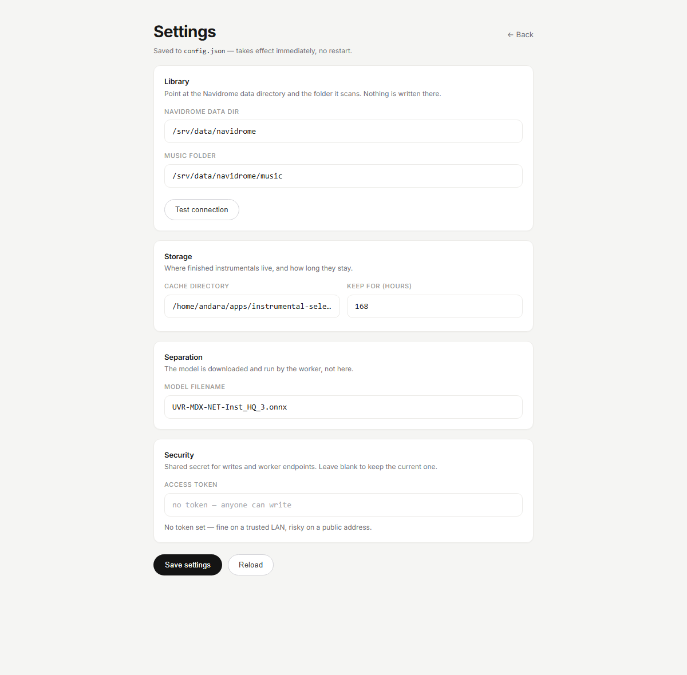

# instrumental-selector

Self-hosted web app that turns tracks from **your** Navidrome library into instrumental (vocal-free) MP3s — using **your own machine** as the compute worker.

No cloud APIs, no uploads to third parties, no API keys. The server stays dumb: it searches, queues and caches. A worker on a laptop or desktop does the actual stem separation.

```
browser ──► server (search · queue · cache · serve)
                 ▲            │
                 │ result     │ source file
                 │            ▼
              worker (ffmpeg → MDX separation → MP3 320k)
```

## Why this shape

Stem separation is CPU-hungry: a 2012-era 4-thread i3 needed **~28 min** for a 6-minute track, while a Ryzen 7 6800HS did the same work in **4:58**. So the server never runs a model — it hands the job to a machine that can. If the worker is asleep, jobs simply wait in the queue.

## Features

- Search your Navidrome library directly from its SQLite DB (no Subsonic credentials needed)
- One-click instrumental with a confirm step; progress and elapsed time in the UI
- Level-matched output (gain computed from the original's integrated loudness)
- 48 kHz / 320 kbps MP3, single lossy encode from the separated stem
- Results cached by track id, auto-deleted after a configurable TTL (default 7 days)
- Queue survives server restarts; a worker that dies mid-job is detected and the job returns to the queue
- Nothing is written into your music library



## Requirements

**Server** (Linux/macOS, any small box): Python 3.11+, read access to a Navidrome data directory.

**Worker** (Windows/Linux/macOS): Python 3.10–3.12, ~1.4 GB disk for the venv, ffmpeg on `PATH`. CPU is enough; a GPU was measured *slower* than CPU for this model class.

## Server setup

```bash
git clone https://github.com/mmoolyaa/instrumental-selector.git
cd instrumental-selector
python3 server.py             # http://127.0.0.1:8899
```

First run defaults to `/srv/data/navidrome`. Everything else is configured in the browser:
open **`/settings`** (gear icon, top right) and fill in the paths. The page has a
**Test connection** button that verifies the data dir, opens `navidrome.db` read-only, counts
tracks and resolves a sample path — so you find a wrong folder before saving it, not after.

Settings are written to `config.json` next to `server.py` (gitignored) and apply immediately,
no restart. Env vars below still work and act as the default for anything unset.

Run it as a service:

```bash
mkdir -p ~/.config/systemd/user
cp deploy/instrumental-selector.service ~/.config/systemd/user/
systemctl --user daemon-reload
systemctl --user enable --now instrumental-selector
```

Put it behind a reverse proxy (see `deploy/Caddyfile.example`) if you want a hostname.

## Docker

```bash
git clone https://github.com/mmoolyaa/instrumental-selector.git
cd instrumental-selector
docker compose up -d --build
```

`compose.yml` mounts your Navidrome data dir and music folder read-only, and keeps
`config.json`, the cache and the job queue in a named volume that survives rebuilds.
Override the paths if yours differ:

```bash
NAVIDROME_DATA=/path/to/navidrome NAVIDROME_MUSIC=/path/to/music docker compose up -d
```

Open `http://localhost:8899`. A fresh install shows a banner naming the exact missing
path, with a button to the settings page — not an empty dashboard. Health lives at
`GET /api/health` and is what the container healthcheck polls.

The image is the **server only** (~180 MB, stdlib, no model). The worker still runs on
your own machine: a torch image is 1.4 GB to do the same job.

## Worker setup

```bash
# Linux / macOS
./deploy/install-worker.sh

# Windows (PowerShell)
py -3.12 -m venv .venv
.venv\Scripts\pip install torch torchvision torchaudio --index-url https://download.pytorch.org/whl/cpu
.venv\Scripts\pip install "audio-separator[cpu]" audioread
```

Then point it at the server and start it:

```bash
export INSTR_SERVER=https://instrumental.example.com
export INSTR_TOKEN=<same value as the server, if set>
python worker.py
```

On Windows, copy `deploy/start-worker.bat` next to `worker.py`, edit `INSTR_SERVER`, and double-click it.

### Install gotchas (learned the hard way)

- Install **CPU torch first** from the PyTorch CPU index, otherwise `audio-separator[cpu]` drags in gigabytes of CUDA wheels.
- `audioread` is an undeclared dependency of `audio-separator` — install it explicitly.
- `torchvision::nms does not exist` means torchvision came from PyPI against a `+cpu` torch. Reinstall it with the same `--index-url`.
- The worker shells out to `ffmpeg`; a missing binary surfaces as `FileNotFoundError: 'ffmpeg'`.
- AAC/m4a does not open directly (`Format not recognised`) — the worker decodes to WAV first, which is expected.

## Configuration

| Variable | Default | Used by | Meaning |
|---|---|---|---|
| `INSTR_LIB` | `/srv/data/navidrome` | server | Navidrome data dir (contains `data/navidrome.db`) |
| `INSTR_MUSIC` | `$INSTR_LIB/music` | server | Music root that DB paths are relative to |
| `INSTR_CACHE` | `./cache` | server | Where finished MP3s live |
| `INSTR_JOBS` | `./jobs.json` | server | Queue state file |
| `INSTR_TTL_HOURS` | `168` | server | Delete cached MP3s older than this |
| `INSTR_LEASE_MINUTES` | `45` | server | A job held by a worker for longer than this is treated as abandoned and requeued |
| `INSTR_TOKEN` | *(empty)* | both | Shared secret; when set, writes and worker endpoints require `X-Instr-Token` |
| `PORT` | `8899` | server | Listen port |
| `INSTR_SERVER` | `http://127.0.0.1:8899` | worker | Base URL of the server |
| `INSTR_MODEL` | `UVR-MDX-NET-Inst_HQ_3.onnx` | worker | Separation model |
| `INSTR_MODELS` | `./models` | worker | Model cache directory |
| `INSTR_SEPARATOR` | `.venv/.../audio-separator` | worker | Path to the CLI |

## API

| Method | Path | Purpose |
|---|---|---|
| GET | `/` | UI |
| GET | `/api/tracks?q=` | Search (`missing=0` only) |
| GET | `/api/stats` | Library/cache/queue/worker counters (+ `configured`, `hint`) |
| GET | `/api/health` | Liveness and library status for healthchecks |
| GET | `/api/cached` | Recently finished instrumentals |
| POST | `/api/jobs` `{id}` | Queue a track (idempotent, cache-aware) |
| GET | `/api/job/<jid>` | `queued` / `running` / `done` / `failed` |
| GET | `/api/audio/<jid>` | Stream MP3 (Range supported) |
| GET | `/api/download/<jid>` | MP3 as attachment |
| GET | `/api/worker/next` | Worker: claim a job (`204` when idle) |
| GET | `/api/worker/source/<jid>` | Worker: download the source file |
| POST | `/api/worker/result/<jid>` | Worker: upload the finished MP3 (raw body) |
| POST | `/api/worker/fail/<jid>` | Worker: report an error |

## Security notes

- Set `INSTR_TOKEN` if the server is reachable by anything but you. Without it, anyone who can reach the port can queue work on your worker.
- The library is opened **read-only**; the app never writes into it.
- Track ids come from the database — the API never accepts a file path.
- Everything stays on your network. No telemetry, no external calls.

## Tests

```bash
python3 test_sel.py     # spins a throwaway server + sqlite DB, asserts the full job lifecycle
```

## How good is the separation?

Honest answer: good for listening, karaoke, practice and background music; not good enough to build a production remix on. MDX removes everything centred in the stereo image, so kick, snare, bass and centre-panned lead guitar lose some body, and harmonies can leave a ghost. The output is level-matched and encoded once, so the pipeline adds no further damage — the ceiling is the model.

Heavier models (e.g. `demucs htdemucs_ft`) separate better at 2–3× the time; point `INSTR_MODEL` at one to try.

## License

MIT — see [LICENSE](LICENSE).
